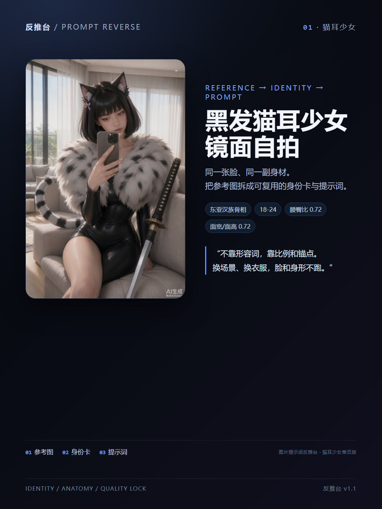
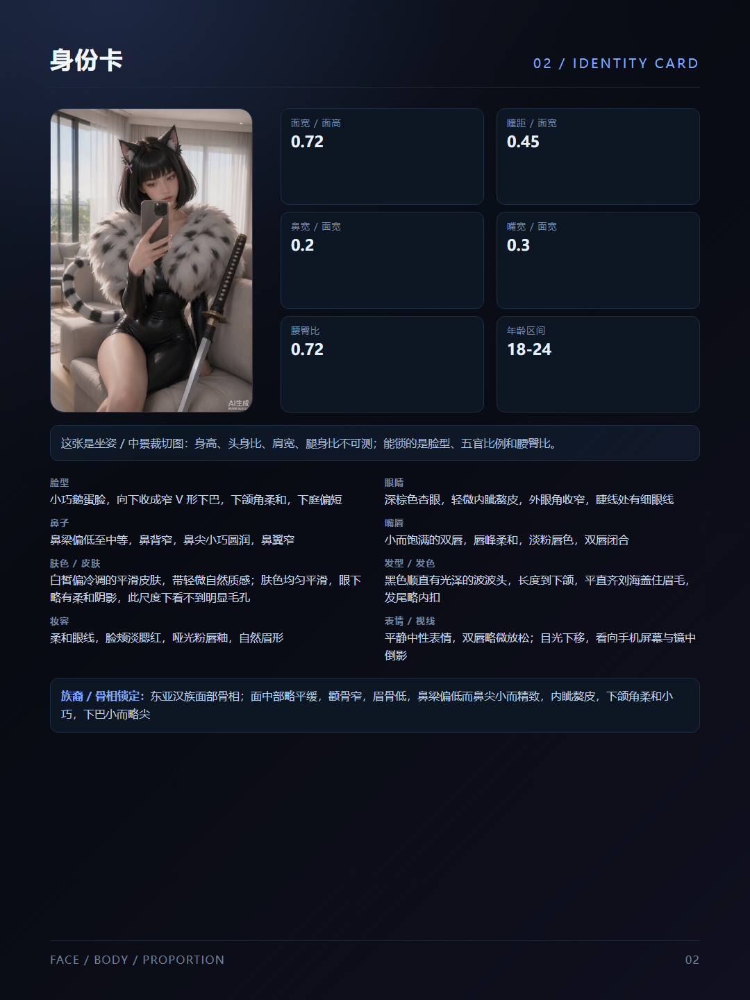
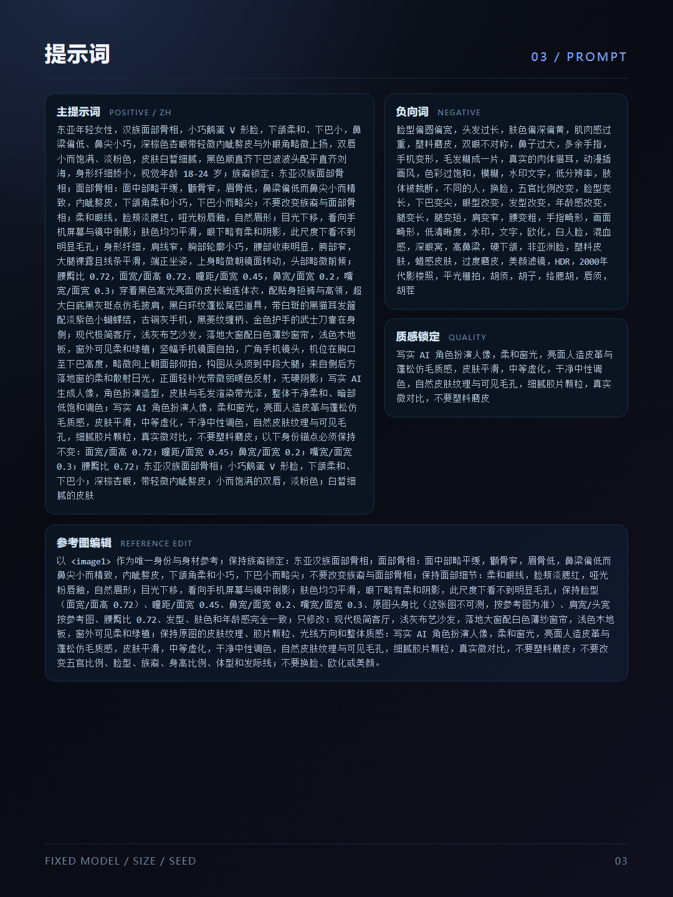

# 图片提示词反推台（DSH 插件）

把一张参考图拆成**身份卡 + 比例 + 技术质感 + 可复用提示词**，用于同一角色换装、换场景、换机位时尽量不跑脸、不跑身材。

这是一个 [DSH（DeepSeek Harness）](https://github.com/deepseek-ai/deepseek-harness) 本地插件，不是手机 App，也没有上架 DSH 插件市场；下载后从本地文件夹安装即可。免费使用，MIT 协议。

<p align="center">
  
  
  
</p>

## 它能做什么

上传一张人物参考图，视觉模型会读出：

- **身份卡**：族裔 / 面部骨相、脸型、眼鼻唇、肤色、发型、妆容、痣 / 疤 / 胡须 / 穿孔 / 纹身
- **比例**：面宽/面高、瞳距/面宽、鼻宽/面宽、嘴宽/面宽、头身比、肩宽/头宽、腰臀比、腿身比
- **技术质感**：相机、镜头、光圈、ISO、快门、焦段、光线、颗粒、调色、景深、后期
- **身体细节 / 动作**：可见裸体、器官、手部动作、手指动作、接触、姿势、机位；只有局部特写时不补脸、不补全身
- **局部特写模式**：`subject_scope = genital_closeup / detail_macro` 时只保留可见局部、手/手指动作、机位和质感

然后编译成多组提示词：

- 主提示词（中 / 英）
- 身份锁定（中 / 英）
- 参考图编辑 · Qwen（`<image1>`）
- 参考图编辑 · 通用（Seedream / Flux Kontext / Gemini / 豆包参考图，不带 `<image1>`）
- 手机一键版（一段可直接粘到豆包 / 即梦 / 文生图）
- 负向提示词、质感锁定、三视图角色设定

还支持手动校正身高、头身比、年龄、性别，以及「身体 / 手部动作补充」；保存后用同一套模板重编译，不重新调用视觉模型。

## 安装

### 方法 A：插件管理

1. 下载本仓库 ZIP（Code → Download ZIP）或 `git clone`。
2. 解压到简单路径，例如 `C:\dsh-plugins\prompt-reverse-workbench`，确保这一层能看到 `package.json`。
3. 打开 DSH → 插件管理 → 安装本地插件 → 选择这个文件夹。
4. 刷新界面；左侧栏出现「反推台」。没有就重启一次 DSH。

### 方法 B：Agent 命令

在 DSH 对话里让 Agent 执行：

```text
plugin_manager install_bundle
target: C:\dsh-plugins\prompt-reverse-workbench
```

安装完成后刷新或重启 DSH。

## 使用

1. 打开「反推台」，上传 / 拖入一张人物参考图。
2. 等反推完成，得到身份卡、比例、技术质感和提示词。
3. **要锁脸换装 / 换场景**：用「参考图编辑」。Qwen 用带 `<image1>` 的版本；Seedream / Flux / Gemini / 豆包参考图用「参考图编辑 · 通用」。把原图上传到参考图，粘贴对应文案。
4. **只想手机随便生成**：用「手机一键版」，整段复制，不带 `<image1>`、不带负向词。
5. **局部特写 / 成人参考**：插件只写可见局部、手 / 手指动作、姿势机位，不补脸、不补全身。

## 环境要求

- DSH `0.2.1` 及以上。
- 一个能读图的视觉模型；默认走 `deepseek-account/deepseek-flash`。
- 参考图编辑需要模型 / API 支持图片输入；API Key 自备。
- 记录与图片保存在本机 `~/.dsh/prompt-reverse`，图片走 attachments；插件本身不上传到第三方图库。

## 实话

- **文生图锁不住真实身份**。文字只能描述，锁脸要参考图编辑。
- 不是像素级同一张脸。原图遮挡 / 裁切越多，能锁的越少。
- NSFW 提示词能写，但豆包 / 即梦 / Qwen 等平台会不会拦，是执行端的事。
- 插件需要能读图的视觉模型；模型 / API 余额不足时会报 402 / 403。

## 卸载

插件管理里删除「图片提示词反推台」，或让 Agent 执行：

```text
plugin_manager remove_bundle
target: @local/prompt-reverse-workbench
```

## License

MIT。见 [LICENSE](LICENSE)。

---

## English

A local DSH plugin that reverse-engineers a reference image into an identity card, body proportions, technical quality, and reusable prompts (Qwen `<image1>` reference edit, generic reference edit for Seedream / Flux / Gemini / Doubao, mobile one-tap prompt, negative prompt, quality lock). Free, MIT. Install from the local folder; it is not on the DSH marketplace.
